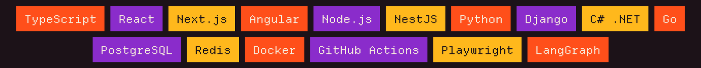
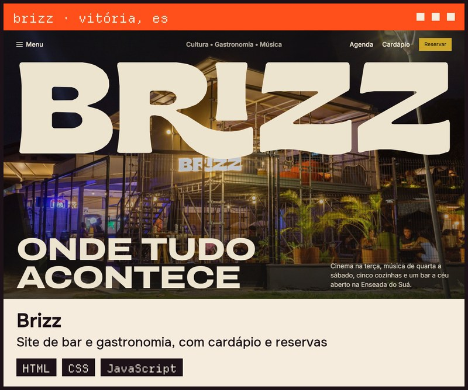
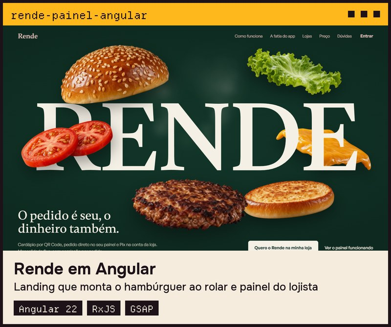
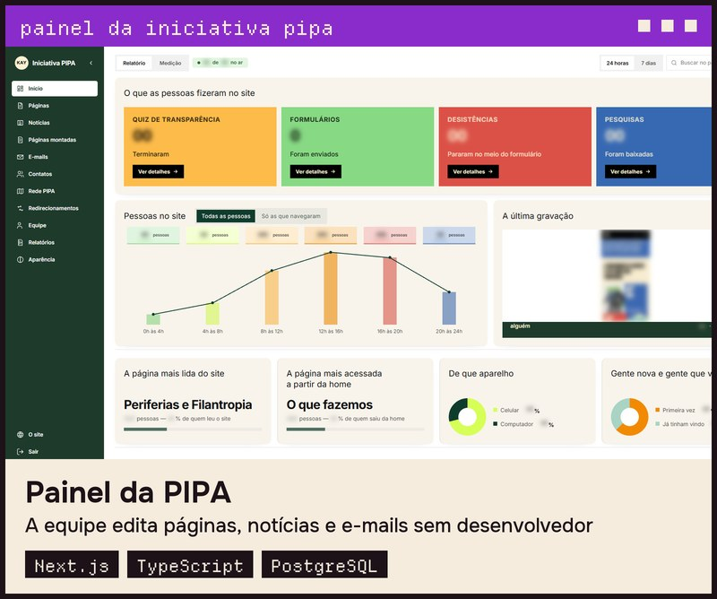
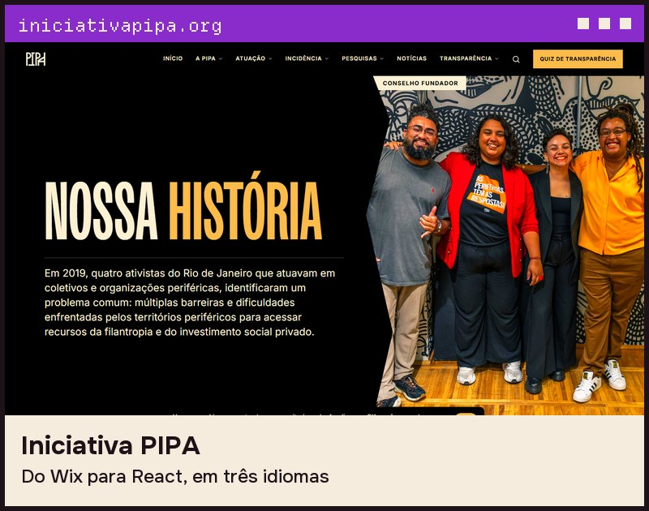
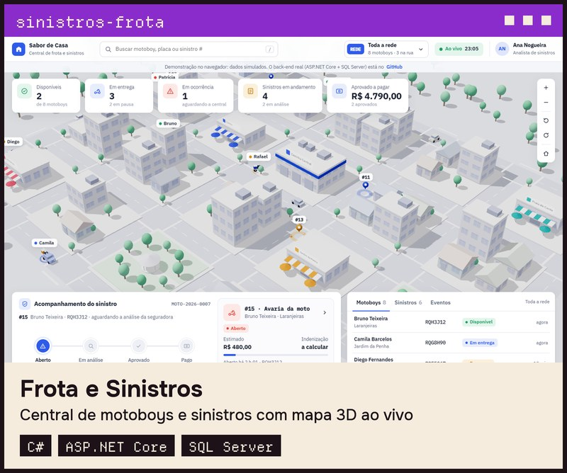
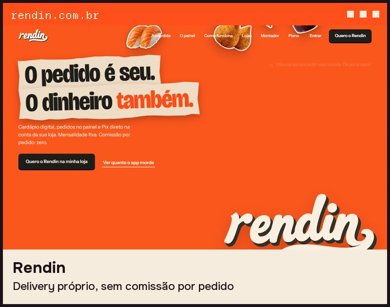
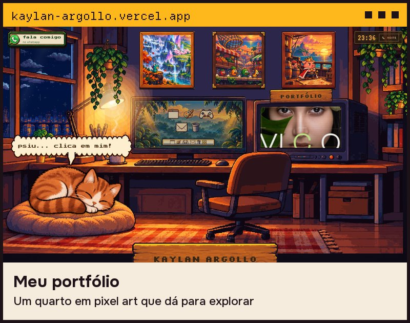
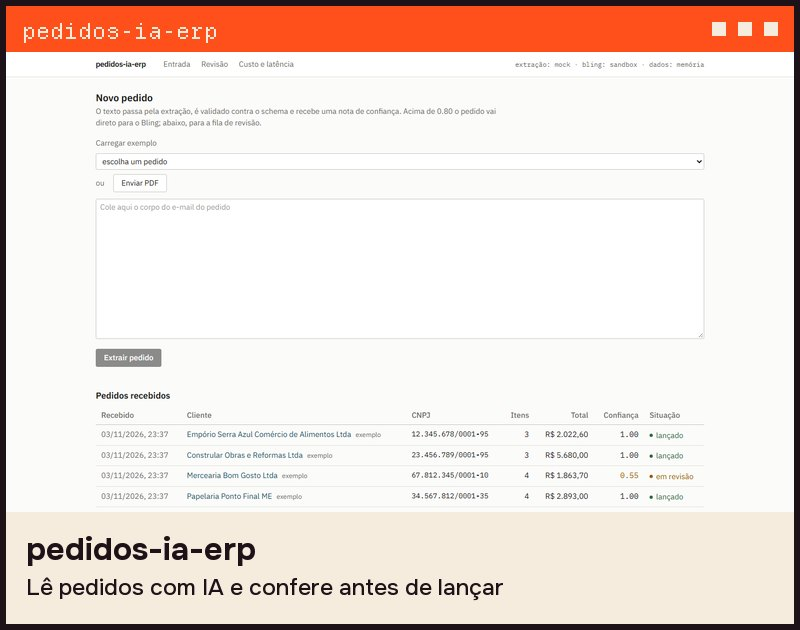

  

  <b>Eu desenho a tela e programo o que roda por trás dela.</b> 
  Tenho dois produtos meus no ar, o <a href="https://encaixae.com.br">Encaixaê</a> e o <a href="https://rendin.com.br">Rendin</a>, e faço sites para bares, ONGs e pequenas empresas.

  

<h3 align="center">projetos</h3>

  
  

  
  

  
  

  
  

  Os dados do painel da PIPA estão desfocados porque são da organização.

<h3 align="center">código</h3>

  <a href="https://github.com/Kaylan00/rende-painel-angular">rende-painel-angular</a> ·
  <a href="https://github.com/Kaylan00/sinistros-frota-dotnet">sinistros-frota-dotnet</a> ·
  <a href="https://github.com/Kaylan00/pedidos-ia-erp">pedidos-ia-erp</a> ·
  <a href="https://github.com/Kaylan00/lastmile-go">lastmile-go</a> 
  <a href="https://github.com/Kaylan00/agenda-api-nestjs">agenda-api-nestjs</a> ·
  <a href="https://github.com/Kaylan00/vitrine-headless">vitrine-headless</a> ·
  <a href="https://github.com/Kaylan00/painel-anuncios">painel-anuncios</a>

<h3 align="center">fala comigo</h3>

  <a href="https://www.linkedin.com/in/kaylansouza/">LinkedIn</a> ·
  <a href="mailto:kaylanargollo16@gmail.com">E-mail</a> ·
  <a href="https://wa.me/5528999087714">WhatsApp</a> ·
  <a href="https://kaylan-argollo.vercel.app">Portfólio</a>

