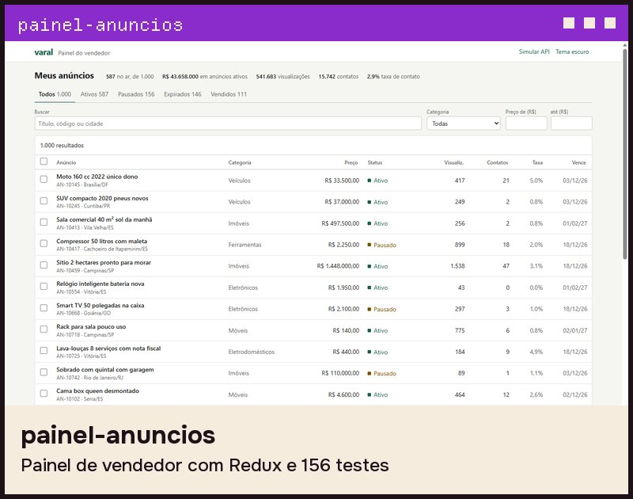
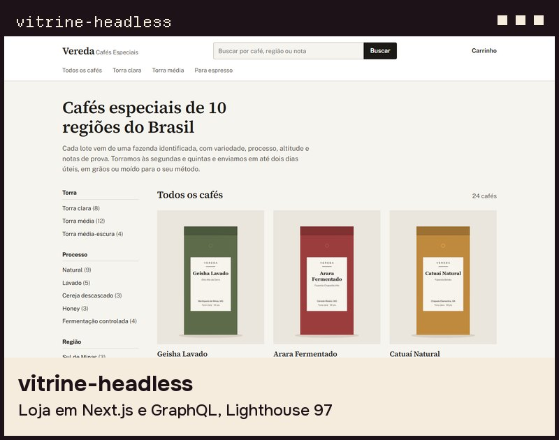

  

Faço telas que as pessoas usam o dia inteiro, em React e TypeScript. Na Seazone, baixei um dashboard de 14 s para 3 s. Hoje mantenho dois produtos meus no ar, o [Encaixaê](https://encaixae.com.br) e o [Rendin](https://rendin.com.br).

  
  

  
  

  
  

**Código:** [painel-anuncios](https://github.com/Kaylan00/painel-anuncios) · [vitrine-headless](https://github.com/Kaylan00/vitrine-headless) · [pedidos-ia-erp](https://github.com/Kaylan00/pedidos-ia-erp) · [lastmile-go](https://github.com/Kaylan00/lastmile-go) · [agenda-api-nestjs](https://github.com/Kaylan00/agenda-api-nestjs) · [rende-painel-angular](https://github.com/Kaylan00/rende-painel-angular)

**Uso no dia a dia:** React, TypeScript, Redux Toolkit, Next.js, Node.js, PostgreSQL, Vitest, Playwright, Docker, GitHub Actions e Claude Code.

**Fala comigo:** [LinkedIn](https://www.linkedin.com/in/kaylansouza/) · [E-mail](mailto:kaylanargollo16@gmail.com) · [WhatsApp](https://wa.me/5528999087714)
